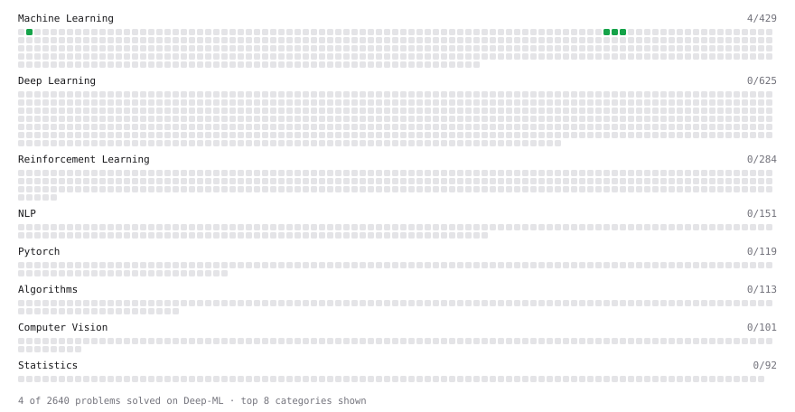

# Deep-ML

My machine learning practice from [Deep-ML](https://www.deep-ml.com). Every solution here was written by hand.

**4** solved · 4 problems · 0 labs · 0 math

[**Browse the interactive portfolio**](https://Gokce-k.github.io/deep-ml/) to replay this filling in over time.

## Problems

| | Difficulty | Solved | |
| --- | --- | --- | --- |
| [Calculate SVM Margin Width](https://www.deep-ml.com/problems/282) | easy | 2026-11-24 | [solution](problems/0282-calculate-svm-margin-width) |
| [Implement Hinge Loss for SVM](https://www.deep-ml.com/problems/283) | easy | 2026-11-24 | [solution](problems/0283-implement-hinge-loss-for-svm) |
| [Implement Polynomial Kernel Function](https://www.deep-ml.com/problems/281) | easy | 2026-11-24 | [solution](problems/0281-implement-polynomial-kernel-function) |
| [Linear Regression Using Gradient Descent](https://www.deep-ml.com/problems/15) | easy | 2026-11-24 | [solution](problems/0015-linear-regression-using-gradient-descent) |

---

_This file is regenerated by Deep-ML on every push._
